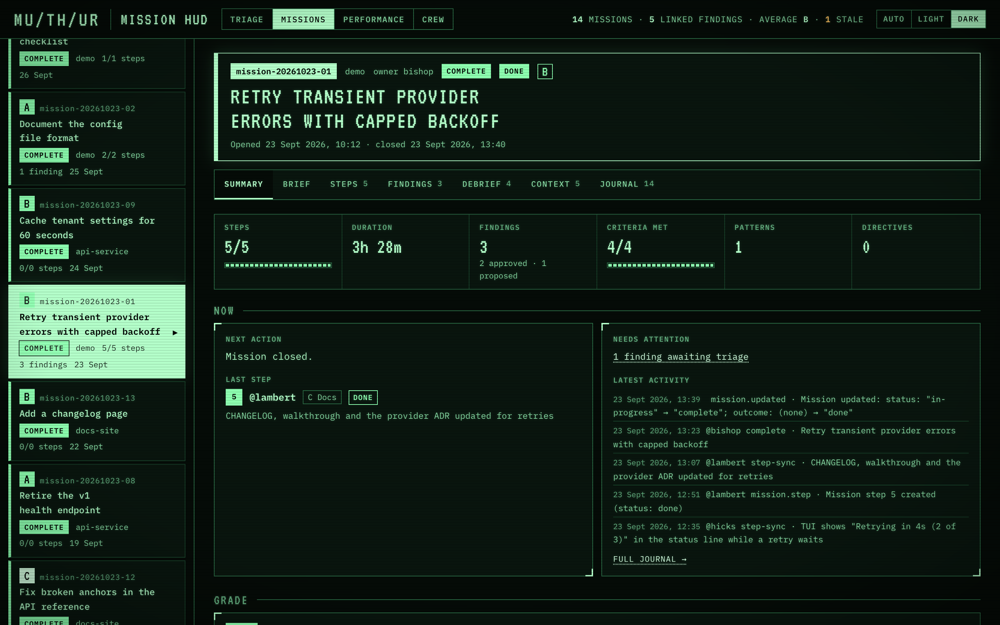
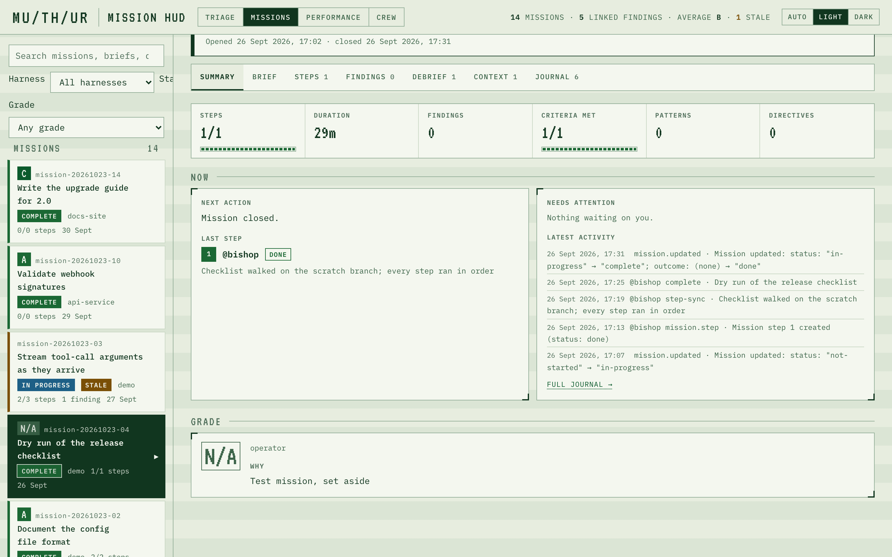

# Mission Grading

Every finished mission gets a grade from **A** to **F**, a short summary of why, and a few suggestions for the next mission. The grades appear on the [mission HUD](Mission-HUD-Guide) and roll up into a per-harness view at `/performance`, so you can see how each connected harness is doing over time.

Grading is the third triage job, after classify and process. It runs nightly at 21:40 and can be run by hand. It works from the database alone: the mission's brief, debrief, steps, findings and agent notes as bishop-memory already holds them. It reads no files and makes no changes to a harness.


## What the grades mean

| Grade | Means |
|---|---|
| **A** | Clean from start to finish: every acceptance criterion met, no rework, no escalation, no real sub-agent mistakes. Rare. |
| **B** | Every criterion met (or all but one minor one), at most one fix round, mistakes caught and corrected inside the mission. A good, normal mission. |
| **C** | Delivered, with noticeable rework: two or more fix rounds, an escalation, or several execution mistakes. Also normal. |
| **D** | Completed with significant problems: a criterion unmet together with repeated rework, or many recorded mistakes. |
| **E** | Completed only nominally: most criteria unmet or deferred. |
| **F** | Failed: outcome `failed`, or no criterion met. |

Most missions should land on **B** or **C**. Findings are not counted against a mission in themselves: a finding that proposes an improvement is the harness learning. Only findings and debrief entries that describe something that went wrong *in this mission* weigh on its grade.

A mission whose record is too thin to judge (no debrief and no steps) gets **not enough evidence** instead of a letter.

**N/A** is not a grade. The operator sets it on a mission that should not count, such as a test mission, and the grader never grades it. See [Setting a mission aside](#setting-a-mission-aside-na).

## Where grades appear

**Mission HUD.** Each graded mission shows its letter in the mission list and in its header, and a **Grade** section under the tiles: the letter, **Why** (the summary), **Suggestions**, and the counts the grade rests on. A mission the operator has set aside shows **N/A** in place of a letter: in the list its note is the tooltip, and in the Grade section the note is under **Why**. The list has a grade filter, including **Ungraded** and **N/A**.



**Performance page** (`/performance`, the third link in the page switch):

- **Summary** — the average grade and score out of 5, an A–F distribution bar over every graded mission, how many are waiting, and how many were set aside, which means the missions that carry no letter and are not waiting (the count is the sum of the insufficient, skipped and excluded rows, `internal/ui/performance.html:540`).
- **Harnesses** — one row per harness: its average letter and score, a count of its N/A missions when it has any, its latest grades newest first (each opens the mission), and **improving**, **slipping** or **steady** when its five newest grades differ from the five before them by a third of a grade or more (a dash with fewer than six). Click a row to filter the grades below to that harness; click it again to clear. **Display…** hides harnesses you do not want to see, such as test harnesses: a hidden harness drops out of the rows, the summary and the grade list, nothing is deleted, and the choice is kept in this browser.
- **Grades** — every verdict, newest first, 20 to a page, filtered by harness and by grade with the buttons above the list (each shows its count; the **N/A** button, shown only when a mission is set aside or the N/A filter is active, lists the set-aside missions; the counts are for the harness in view, `internal/ui/performance.html:527` and `:532`, so with one harness selected the button shows only that harness's N/A missions). **Full verdict** expands a long summary and **Suggestions** shows what to change next time.

The average counts A as 5 down to F as 0 and turns the result back into the nearest letter.

**Triage Runs tab.** Each grading run is listed with kind `grade`, its model, and how many missions it read and graded.

## What the grader sees

For each mission, bishop-memory assembles a compact **grading packet**:

- the mission row (id, title, harness, outcome, dates);
- **signals** the service counts itself: acceptance criteria met, partial, unmet and unclear (read from the result word after each criterion in the debrief, such as `— pass` or `— partial`), steps by status, injected steps such as `2a`/`2b` (usually fix rounds), escalation steps, QA steps, blocked events, and findings by status;
- the brief's goal and acceptance criteria;
- the debrief's judgement sections: Mission Summary, Acceptance Criteria Outcome, Tracker And Reality, Wrong Assumptions, Sub-Agent Mistakes, QA Verdict;
- one line per step, per finding and per agent note.

Every text is capped, so ten missions make one small read. The signals are stored with each grade and shown under it, so any letter can be checked against the facts it rests on.

## Running it

The schedule runs it nightly. To run it now:

```sh
make triage-grade                       # the next 10 ungraded finished missions
make triage-grade LIMIT=5               # fewer
make triage-grade MISSIONS=mission-20261009-03,mission-20261009-04
make triage-grade MISSIONS=mission-20261009-03 REGRADE=1   # replace an existing grade
```

A run with nothing waiting exits at once without starting an agent. Each run makes one pass: the grader claims at most ten missions, grades them, writes every verdict in one call and stops.

## No loops

- A grade, or a "not enough evidence" verdict, is final. A graded mission is never picked up again on its own.
- A mission a run claimed but did not grade (the run failed or timed out) is retried by **one** later run. If that one fails too, the mission is marked **skipped** and left alone.
- The only way to grade a mission again is `REGRADE=1` with its id, or `DELETE /v1/mission-grades/<id>`. No agent can do either.
- An excluded (N/A) mission is never claimed. A run that names one skips it with a log line and leaves it alone; `DELETE /v1/mission-grades/<id>` answers 409 for it. Lift the exclusion first, and the nightly grader can claim the mission again.

## Setting a mission aside (N/A)



Only the operator sets this. No MCP tool reaches these routes. Both are on the HTTP API under `/v1/mission-grades/:missionID/exclusion`; the operator's side of the service is in [Developer: HTTP API](Developer-HTTP-API#mission-grades-operator-na).

```sh
# the key stays off the command line: curl reads it from a mode-600 header file
. ~/.config/bishop-memory/client.env
(umask 077 && printf 'Authorization: Bearer %s\n' "$BISHOP_MEMORY_API_KEY" > ~/.config/bishop-memory/auth.header)

# set aside: the note says why, and is required (not blank, at most 700 characters)
curl -fsS -X PUT -H @"$HOME/.config/bishop-memory/auth.header" -H 'Content-Type: application/json' \
  -d '{"note":"test mission, not a real run"}' "$BISHOP_MEMORY_URL/v1/mission-grades/mission-20261009-03/exclusion"

# lift it: the mission is ungraded again and the nightly grader can claim it
curl -fsS -X DELETE -H @"$HOME/.config/bishop-memory/auth.header" \
  "$BISHOP_MEMORY_URL/v1/mission-grades/mission-20261009-03/exclusion"

# the header file holds the key in plain text and is not removed by the commands above
rm -f ~/.config/bishop-memory/auth.header
```

- The mission must be finished. An unknown mission answers 404; an unfinished one answers 409.
- Setting replaces any existing row, whether it held a verdict, a claim or a skip. The response reports the `previous_state` and `previous_grade` it replaced.
- An excluded mission is left out of the averages, the distribution and the trend, and counted under N/A on the Performance page.
- The grader never claims it, an explicit claim naming it refuses the whole batch with 409, and a grader's verdict never overwrites it.
- A mission set aside by hand before this route existed (`state = 'insufficient'` with `grade` NULL) is converted by the same PUT. That workaround is superseded by the route.

### Upgrading a live database

A database created before this change is widened the first time memoryd starts after the upgrade. The `mission_grades` table is rebuilt once, in one transaction, keeping every row, and the rebuild is idempotent after that. If the rebuild fails, it rolls back, memoryd logs a `WARNING` and keeps running, and the exclusion route answers 500 until the rebuild succeeds.

Back up the database before restarting the service, at the `DB_PATH` the running service uses. `memoryd backup` writes a consistent copy and refuses a target that already exists. Find that `DB_PATH` for your install:

- **launchd on a Mac** (including a Mac server install): the job's plist sets `DB_PATH=data/memory.db`, relative to its `WorkingDirectory`, which is the checkout (`scripts/com.bishop-memory.memoryd.plist:32-33`). The database is `<checkout>/data/memory.db` (`docs/wiki/Server-Install.md:169`).
- **Linux systemd**: the unit sets `Environment=DB_PATH=/var/lib/bishop-memory/memory.db` (`scripts/bishop-memory.service:68`).

The settings file does not carry `DB_PATH` on either install: `memoryd.env` holds the host, port, environment and TLS paths only (`scripts/install.sh:120-127`).

On a Mac, from the checkout:

```sh
export DB_PATH=data/memory.db
: "${DB_PATH:?set DB_PATH first}"
bin/memoryd backup data/memory-before-na.db
# alternative to the line above, with the sqlite3 command line tool; use one, not both:
# sqlite3 "$DB_PATH" ".backup data/memory-before-na.db"
# the copy must hold the tables, not be empty: this lists mission_grades
sqlite3 data/memory-before-na.db ".tables"
```

Run `bin/memoryd backup` from the checkout, as above. `DB_PATH` is relative, so a run from any other directory (for example, with the full path to the binary) opens and creates an empty `data/memory.db` there, because `store.Open` creates the database file on open: its `db.Ping` call forces the driver to create the file (`internal/store/sqlite.go:66-71`). The backup is then empty and the stray file must be removed. The `.tables` check catches the empty copy; do not restart on it.

On Linux the database is in the service user's StateDirectory (`scripts/bishop-memory.service:68`), so run the backup as that user and keep the target inside that directory. The unit's own comment uses `sudo -u bishop-memory env DB_PATH=... <bin>/memoryd keys add` (`scripts/bishop-memory.service:73`), and `scripts/install.sh:176` runs the same pattern with `runuser -u`. `<install root>` is the directory the unit runs `bin/memoryd` from (`scripts/bishop-memory.service:54`):

```sh
export DB_PATH=/var/lib/bishop-memory/memory.db
: "${DB_PATH:?set DB_PATH first}"
sudo -u bishop-memory env DB_PATH="$DB_PATH" <install root>/bin/memoryd backup /var/lib/bishop-memory/memory-before-na.db
sudo -u bishop-memory sqlite3 /var/lib/bishop-memory/memory-before-na.db ".tables"
```

If the `.tables` line prints nothing, the copy is empty. Do not restart until it lists `mission_grades`.

The migration runs only when the operator restarts memoryd, so nothing changes until then. On a Mac, the redeploy is `scripts/install-daemon.sh`: it builds `bin/memoryd`, stages a copy into the exec directory that launchd runs (`scripts/install-daemon.sh:260-264`, `:277-282`), and replaces the launchd job with a bootout and a bootstrap (`scripts/install-daemon.sh:315-331`). The migration runs when that new process starts, in `cmd/memoryd/main.go:121`. Take the backup above first, so that a bad redeploy can be rolled back from it.

## Settings

| Variable | Default | Purpose |
|---|---|---|
| `TRIAGE_GRADE_ENGINE` | `TRIAGE_ENGINE` | `claude` or `opencode` for grading only |
| `TRIAGE_GRADE_MODEL` | `opencode-go/glm-5.2` on opencode, `sonnet` on claude | Model |
| `TRIAGE_GRADE_LIMIT` | 10 | Missions per run, 1–10 |
| `TRIAGE_TIMEOUT_MIN` | 20 for a grade run | Stop a run still going after this many minutes |

`scripts/install-triage-schedule.sh --grade-at HH:MM` moves the nightly slot.

## About these screenshots

The images come from made-up demo data (`make screenshots`); the harnesses `api-service` and `docs-site` and their grades are invented.
